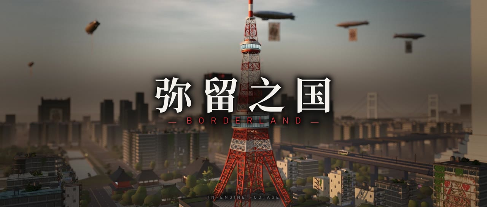
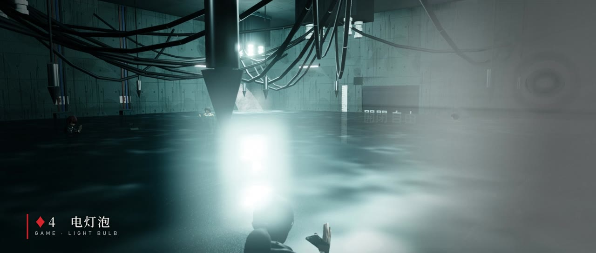
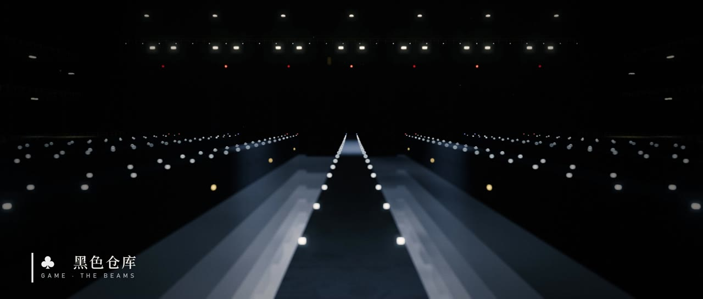
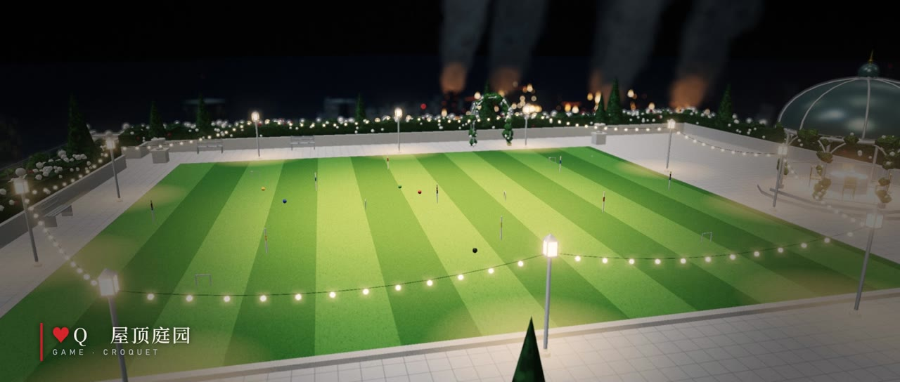
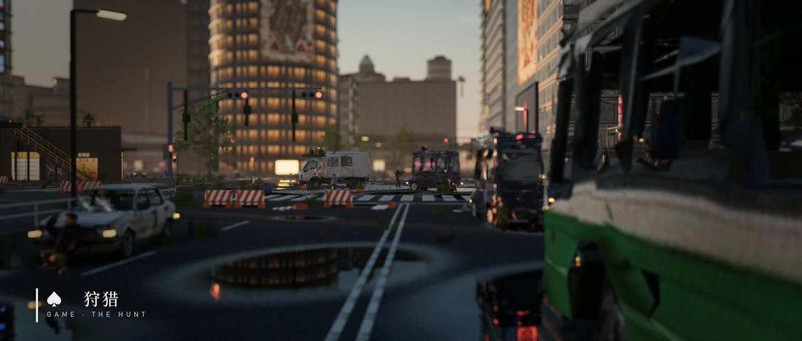

# Gorest-AliceinBorderland

**弥留之国 · BORDERLAND**, a browser-playable Alice in Borderland tribute by [Gorest](https://gorest.ai).



An abandoned Tokyo you can walk through in the browser, built with Three.js. It's a fan tribute to *Alice in Borderland*
(今際の国のアリス). The city is empty and card airships drift overhead. Across the districts are the deadly game venues
from the show, and one of them (♦4 「電球」 Light Bulb) is fully playable.

一座可以在浏览器里漫游的空城东京（Three.js），致敬《弥留之国的爱丽丝》。人去城空，飞艇挂着扑克牌在天上巡游，
各个街区散布着剧中的死亡游戏场地，其中 ♦4「电灯泡」可以完整游玩。

| | |
|---|---|
|  |  |
|  |  |

## What's in it

- **A compressed Tokyo (~2.9 × 1.7 km):**
  - The real building footprints around Shibuya and Tokyo Tower come from Japan's open 3D city data,
    [Project PLATEAU](https://www.mlit.go.jp/plateau/).
  - Two real models are walkable: the underground mall beneath the Shibuya scramble, and the Port City Takeshiba
    interior.
  - Overgrown streets, abandoned cars, crows by day, and day → dusk → night lighting.
- **Game venues:** the night compound with the Q♥ card tower, the ♦K courtroom at the top of a tower, the ♣ black
  warehouse with its beams over fog pits, the ♣ tower's rooftop venue, the ♥Q croquet garden, the Shibuya hunt, the
  prison and the burning district.
- **Playable ♦4 「電球」:**
  - Walk into the underground storm-water tank and the shutter seals behind you.
  - The floor floods. Three breakers, one bulb behind a 開閉自由 door; find the right one before the water reaches
    the electrodes.
- **Rendering:**
  - Post-processing: GTAO, bloom, depth of field, screen-space sun shafts and a teal/amber film grade.
  - Height fog and procedural trees.
  - A lite mode for integrated GPUs.

## Run it

```bash
npm install
python tools/serve.py 8765
```

Open http://localhost:8765, pick a district from the list, and press ▶ to walk around: WASD to move, Shift to run,
Space to jump, V to switch to first person. On Windows, `tools/launch.ps1` starts the server and opens the city in
your browser.

## The trailer

Every shot in the trailer is recorded in the engine; nothing is filmed or composited from outside footage. The music
and sound design are synthesised in code, with no samples. All of it is reproducible from `trailer/`:

```bash
bash trailer/render.sh       # headless Chrome on the GPU, virtual clock, frame-by-frame capture of every shot
python trailer/music.py      # procedural score synced to the cut (trailer/edl.py)
python trailer/edit.py       # assemble picture, titles and card flashes; mux with ffmpeg
```

The game server has to be running for `render.sh`. The recorder steps the game frame by frame over the Chrome
DevTools protocol, so render speed never affects smoothness.

## Credits and license

- **Code:** MIT.
- **Assets (card paintings, models):** CC BY 4.0.
- **PLATEAU city data:** © MLIT Japan, used with attribution.

See [LICENSE](LICENSE) and [CREDITS.md](CREDITS.md). This is an unofficial fan project, not affiliated with Netflix,
ROBOT or Haro Aso.
